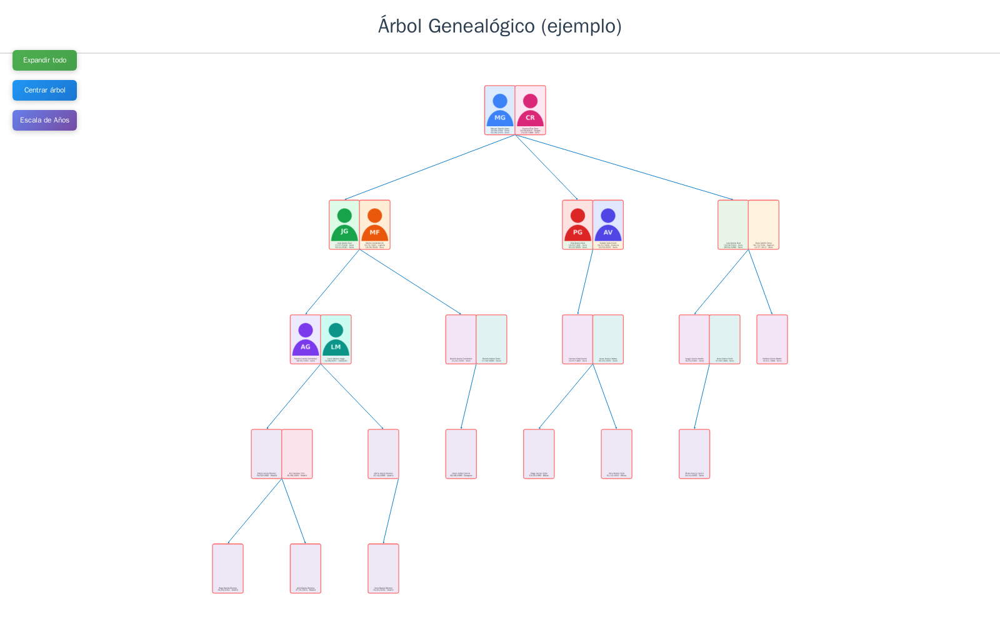

# Árbol genealógico familiar

Web estática para ver el árbol genealógico de una familia en el navegador.
No necesita base de datos ni servidor de aplicaciones: son unos pocos ficheros
HTML/CSS/JS y **un JSON con los datos** y **una carpeta con las fotos**.

Pensada para que la use cualquier familia: clonas el repositorio, cambias
`familia.json` y las fotos, y ya tienes tu árbol.



## Qué hace

- Cada **ficha** es una persona; las parejas aparecen unidas por una línea rosa.
- Los hijos cuelgan de su pareja de padres con líneas azules.
- Cada ficha muestra nombre, fecha y lugar de nacimiento y, si la hay, fecha y
  lugar de defunción, con la foto arriba.
- **Clic** en una ficha: resalta las fichas conectadas.
- **Doble clic** (doble toque en el móvil): despliega o pliega sus hijos.
- Botones:
  - **Expandir todo**: muestra todas las generaciones.
  - **Centrar árbol**: encuadra todo el árbol en pantalla.
  - **Escala de Años**: coloca a cada persona según su año de nacimiento, con
    franjas por década, para ver la historia de la familia en el tiempo.
- Funciona con ratón y con pantalla táctil, y se adapta al móvil.

## Verlo en tu ordenador en un minuto

El árbol carga `familia.json` con `fetch()`, así que **no vale abrir
`index.html` haciendo doble clic** (el navegador bloquea la lectura del fichero
por seguridad). Hay que servirlo con un servidor web cualquiera:

```bash
git clone https://github.com/iwanttobefreak/arbol-genealogico.git
cd arbol-genealogico

# opción 1: Python (ya viene instalado en Linux y macOS)
python3 -m http.server 8000

# opción 2: si prefieres Docker
docker run --rm -p 8000:80 -v "$PWD":/usr/share/nginx/html:ro nginx:alpine
```

Abre <http://localhost:8000> y ya está.

## Estructura del proyecto

```
arbol-genealogico/
├── index.html                 # la página (título y botones)
├── styles.css                 # estilos del marco, botones, móvil...
├── script.js                  # dibujo del árbol (Cytoscape.js) + CONFIG
├── familia.json               # TUS DATOS (aquí va tu familia)
├── fotos/                     # las fotos de las fichas
├── docs/captura.png           # captura para este README
└── herramientas/
    ├── validar.py             # comprueba familia.json y las fotos
    └── crear_fotos_ejemplo.py # genera las fotos de ejemplo
```

Todo es estático: se puede publicar en GitHub Pages, en un nginx, en un Apache
o en cualquier hosting, sin PHP ni base de datos.

## Cómo meter a tu familia

`familia.json` es un **árbol**: cada nodo es una pareja (o una persona sola) y
tiene una lista `children` con sus hijos, que a su vez son parejas con sus
propios `children`, y así hasta donde tengas datos.

### Ejemplo mínimo

```json
{
  "title": "La familia de mi abuela",
  "husband": "Manuel García López",
  "husbandBirthPlace": "Soria",
  "husbandBirthDate": "12/03/1901",
  "husbandDeathPlace": "Soria",
  "husbandDeathDate": "05/06/1978",
  "husbandPhoto": "./fotos/manuel.jpg",
  "wife": "Carmen Ruiz Sanz",
  "wifeBirthPlace": "Burgos",
  "wifeBirthDate": "21/09/1904",
  "wifePhoto": "./fotos/carmen.jpg",
  "children": [
    {
      "husband": "José García Ruiz",
      "husbandBirthDate": "07/07/1928",
      "wife": "Marta Fernández Gil",
      "children": []
    }
  ]
}
```

El fichero que viene en el repositorio (`familia.json`) es un ejemplo completo
con 5 generaciones y **datos inventados**: úsalo como plantilla y ve
sustituyéndolo por los tuyos.

### Campos

| Campo | Obligatorio | Qué es |
|---|---|---|
| `title` | no | Título de la pestaña y de la cabecera. Solo en el nodo raíz. |
| `husband` | sí | Nombre de la persona principal del nodo. |
| `husbandBirthDate` | no | Fecha de nacimiento, `DD/MM/AAAA` (p. ej. `04/11/1909`). |
| `husbandBirthPlace` | no | Lugar de nacimiento. |
| `husbandDeathDate` | no | Fecha de defunción, mismo formato. |
| `husbandDeathPlace` | no | Lugar de defunción. |
| `husbandPhoto` | no | Ruta a la foto, por ejemplo `./fotos/manuel.jpg`. |
| `wife` y `wife…` | no | Igual que los cinco campos anteriores, para la pareja. |
| `children` | no | Lista de nodos hijos (cada uno con la misma estructura). |
| `name` | no | Etiqueta interna; no se muestra. Útil para anotar «rama de…». |

Detalles que conviene tener claros:

- **`husband` es siempre la persona de la que cuelgan los hijos**, sea hombre o
  mujer. Si en un matrimonio quieres que los hijos dependan de la mujer, ponla
  como `husband` y al marido como `wife`. La etiqueta solo cambia el color de la
  ficha (azul/rosa), no el significado.
- **Persona sin pareja**: omite `wife` (o ponla vacía) y deja sus `children`.
  La ficha se dibuja sola y sus hijos cuelgan de ella.
- **Fechas**: siempre `DD/MM/AAAA`. Si solo conoces el año, pon `01/01/1900` o
  déjalo vacío (mejor vacío que inventarlo). `null` también vale.
- **Hijos**: el orden de la lista `children` es el orden en que aparecen en el
  árbol, de izquierda a derecha.
- Las **comillas deben ser rectas** (`"`), no tipográficas (`“ ”`), y no puede
  haber una coma detrás del último elemento de un objeto o lista. Es el error
  más habitual; si el árbol no sale, valida el fichero con
  <https://jsonlint.com>.

### Comprobar que no te has equivocado

```bash
python3 herramientas/validar.py
```

Revisa el JSON, que todas las personas tengan nombre, que las fechas tengan el
formato correcto y que existan todas las fotos referenciadas. También avisa de
nombres repetidos (normalmente un copiar-pegar).

## Fotos

- Formato: JPG, PNG o WebP. Recomendado JPG de calidad media.
- Tamaño: la ficha mide 150×240 px y la foto ocupa la parte superior, así que
  con **300×400 px** (el doble) se ve perfecta en pantallas retina. No hace
  falta más; así el árbol carga rápido.
- La foto se recorta con `contain` desde arriba: lo importante es que la cara
  esté en la mitad superior. Si la foto es muy horizontal, recórtala antes a
  formato vertical (por ejemplo con <https://www.photopea.com> o con
  `convert foto.jpg -gravity north -crop 3:4 +repage nueva.jpg`).
- Nombre del fichero: sin espacios, sin acentos y sin `ñ` (`jose-garcia.jpg`,
  no `José García.jpg`). Solo letras, números, guion y guion bajo.
- Guarda las fotos en `fotos/` y usa rutas relativas: `./fotos/jose-garcia.jpg`.
- La foto es opcional: si no la pones, la ficha sale con su color y su texto.
- Si escaneas fotos antiguas, procura que todas tengan un fondo y un encuadre
  parecidos; el árbol gana muchísimo en legibilidad.

## Publicarlo

### GitHub Pages (gratis)

1. Sube el contenido a un repositorio de GitHub (público o privado).
2. En el repositorio: **Settings → Pages**.
3. En *Build and deployment* elige **Deploy from a branch**, rama `main` y
   carpeta `/ (root)`. Guarda.
4. En un par de minutos estará en
   `https://TU-USUARIO.github.io/arbol-genealogico/`.

### Tu propio servidor (nginx)

```nginx
server {
    listen 443 ssl;
    server_name arbol.mifamilia.example;
    root /var/www/arbol-genealogico;
    index index.html;

    # que el JSON no se cachee mientras lo editas
    location = /familia.json {
        add_header Cache-Control "no-cache";
    }
}
```

Apunta el dominio a tu servidor, pon el certificado (Let's Encrypt) y listo.
Con Apache es igual de simple: copia la carpeta en el `DocumentRoot`.

### Importante

- El sitio tiene que servirse por **http(s)**, no abrirse como fichero local.
- No renombres `familia.json` sin cambiar también la línea
  `fetch('familia.json')` de `script.js`.

## Personalizar el aspecto

Casi todo lo que se suele tocar está al principio de `script.js`, en el objeto
`CONFIG`:

```js
const CONFIG = {
    nodeWidth: 150,          // ancho de la ficha
    nodeHeight: 240,         // alto de la ficha
    photoHeightRatio: 0.8333,// % del alto que ocupa la foto
    spacingX: 190,           // separación horizontal entre fichas
    spacingY: 560,           // separación vertical entre generaciones
    minZoom: 0.1,            // límites de zoom
    maxZoom: 2,
    colors: [                // [fondo hombre, borde hombre, fondo mujer, borde mujer] por generación
        ['#e3f2fd', '#1976d2', '#fce4ec', '#e91e63'], // raíz
        ['#e8f5e8', '#4caf50', '#fff3e0', '#ff9800'], // hijos
        ['#f3e5f5', '#9c27b0', '#e0f2f1', '#009688'], // nietos
        ['#ede7f6', '#673ab7', '#fce4ec', '#e91e63']  // bisnietos y siguientes
    ]
};
```

- Si aumentas `nodeWidth`/`nodeHeight`, sube también `spacingX`/`spacingY`
  (regla práctica: `spacingX` ≥ `nodeWidth` + 40 y `spacingY` ≥ `nodeHeight` + 120).
- Para árboles muy grandes conviene bajar `spacingY` y aumentar `maxZoom`.
- Los textos de los botones están en `index.html`; el título, en `title` de
  `familia.json` (o en el `<h1>` de `index.html`).
- Si quieres otra tipografía, cámbiala en `styles.css` (`font-family`).

## Privacidad: léelo antes de publicar

Un árbol genealógico son **datos personales** (y las fotos, aún más). Antes de
ponerlo en internet:

- **Personas vivas**: piensa si quieres publicar sus nombres, fechas y fotos.
  En muchos países necesitas su consentimiento. Una opción habitual es mostrar
  solo nombre y foto, sin fechas, para los nacidos hace menos de ~100 años.
- **Repositorio privado**: si el árbol es solo para la familia, usa un repo
  privado de GitHub y publica con contraseña (nginx `auth_basic`) o compártelo
  por la red local. GitHub Pages gratuito **solo** sirve repos públicos.
- **Fotos**: usa copias reducidas, no los originales con metadatos EXIF (que
  pueden incluir GPS). `convert foto.jpg -resize 300x400^ -gravity north \
  -extent 300x400 -strip salida.jpg` quita los metadatos.
- **Buscadores**: si publicas el árbol, valora añadir un `robots.txt` con
  `Disallow: /` y una etiqueta `<meta name="robots" content="noindex">`.
- Revisa qué publicas: nombres completos de menores, direcciones o fechas
  exactas son información sensible.

## Problemas frecuentes

| Síntoma | Causa | Solución |
|---|---|---|
| Página en blanco y consola con error de `fetch` | Abierto como `file://` | Sírvelo con `python3 -m http.server` |
| «Error al cargar familia.json» | JSON mal escrito | `python3 herramientas/validar.py` o jsonlint |
| Solo sale la pareja raíz sin hijos | `children` mal anidados o sin `husband` | Revisa la estructura con el validador |
| No se ven las fotos | Ruta o nombre de fichero | Rutas relativas `./fotos/...`, sin espacios ni acentos |
| El texto se sale de la ficha | Nombres y lugares muy largos | Acorta el texto o sube el alto de la ficha en `CONFIG` |
| Todo diminuto al abrir | Árbol muy grande | Usa **Centrar árbol** y el zoom, o reduce `spacingY` |
| Los acentos salen raros | Fichero guardado en otra codificación | Guarda `familia.json` en UTF-8 |

## Créditos

- Dibujo del grafo: [Cytoscape.js](https://js.cytoscape.org/).
- Utilidades: [jQuery](https://jquery.com/).
- Idea y desarrollo original: un árbol familiar autoconstruido en casa, ahora
  liberado como plantilla para quien lo quiera usar.

## Licencia

MIT. Úsalo, modifícalo y compártelo libremente (ver [LICENSE](LICENSE)).
